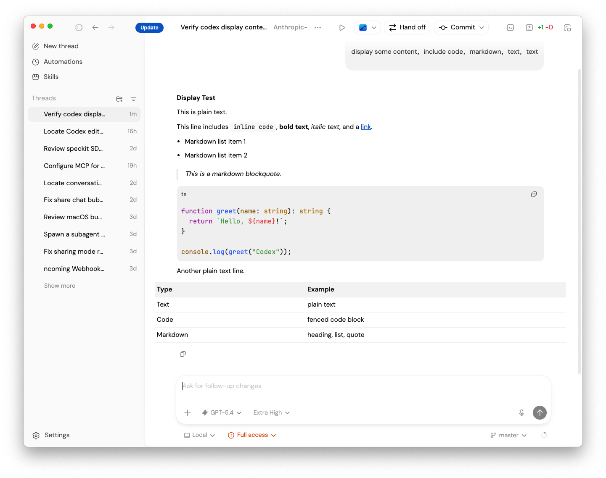
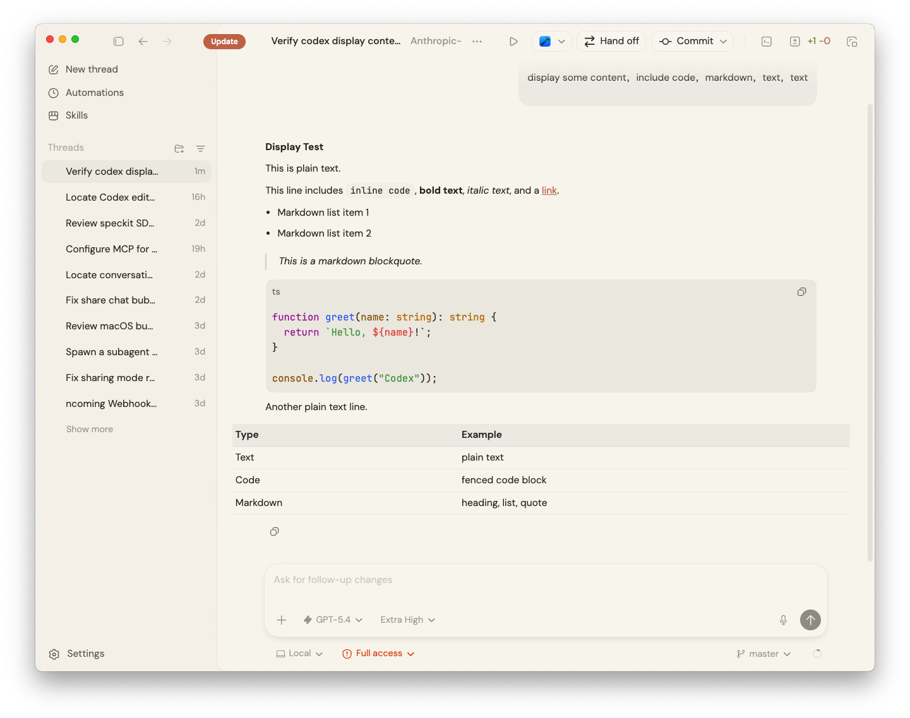

# Anthropic Codex Theme

[中文](./README.md) | **English**

Light and dark presets for Codex, tuned to match Claude Desktop's look and feel.

## Preview

| Codex Default | Anthropic Theme |
|:---:|:---:|
|  |  |

## Import

1. Copy the share string below (or from `share/claude-desktop-light.txt`):

```
codex-theme-v1:{"codeThemeId":"codex","variant":"light","theme":{"accent":"#CA7554","contrast":25,"fonts":{"code":"\"JetBrains Mono\", ui-monospace, \"SFMono-Regular\", \"Cascadia Mono\", Menlo, Consolas, monospace","ui":"\"DM Sans\", system-ui, -apple-system, BlinkMacSystemFont, \"Segoe UI\", Roboto, \"Helvetica Neue\", Arial, sans-serif"},"ink":"#38342E","opaqueWindows":true,"semanticColors":{"diffAdded":"#739245","diffRemoved":"#C37967","skill":"#CA7554"},"surface":"#F8F6F1"}}
```

2. Open Codex → Settings → Themes → **Import**.
3. Paste the string. Done.

**Dark mode:**

```
codex-theme-v1:{"codeThemeId":"codex","variant":"dark","theme":{"accent":"#CA7554","contrast":55,"fonts":{"code":"\"JetBrains Mono\", ui-monospace, \"SFMono-Regular\", \"Cascadia Mono\", Menlo, Consolas, monospace","ui":"\"DM Sans\", system-ui, -apple-system, BlinkMacSystemFont, \"Segoe UI\", Roboto, \"Helvetica Neue\", Arial, sans-serif"},"ink":"#E8E4DC","opaqueWindows":true,"semanticColors":{"diffAdded":"#7FA84A","diffRemoved":"#C37967","skill":"#CA7554"},"surface":"#1E1D1B"}}
```

## Fonts (optional)

The theme works out of the box with system fonts. For the closest Anthropic feel, install:

| Font | Download |
|---|---|
| **DM Sans** | [Google Fonts](https://fonts.google.com/specimen/DM+Sans) |
| **JetBrains Mono** | [JetBrains](https://www.jetbrains.com/lp/mono/) |

<details>
<summary>Install commands</summary>

**macOS (Homebrew)**
```bash
brew install --cask font-jetbrains-mono font-dm-sans
```

**Windows** — Download, select all `.ttf` → right-click → Install for all users.

**Linux**
```bash
mkdir -p ~/.local/share/fonts
# copy .ttf files there
fc-cache -fv
```

</details>

## What Changes

| Property | Light | Dark |
|---|---|---|
| Surface | `#F8F6F1` warm ivory | `#1E1D1B` carbon |
| Ink | `#38342E` warm dark | `#E8E4DC` warm ivory |
| Accent | `#CA7554` muted copper | `#CA7554` muted copper |
| Contrast | 25 | 55 |
| Fonts | DM Sans + JetBrains Mono | DM Sans + JetBrains Mono |

## Limitations

Codex import only supports: `surface`, `ink`, `accent`, `contrast`, `fonts`, `opaqueWindows`, `semanticColors`. You cannot independently color the sidebar vs. main canvas — `contrast` is the only lever for panel separation.

## Files

```text
share/
  claude-desktop-light.txt      Import string (light)
  claude-desktop-dark.txt       Import string (dark)
themes/
  claude-desktop-light.json     Full VS Code theme
  claude-desktop-dark.json      Full VS Code theme
src/
  theme-spec.mjs                Source of truth
```

## Rebuild

```bash
npm run build      # regenerate themes/ and share/
npm run validate   # build + check JSON + share string format
```
