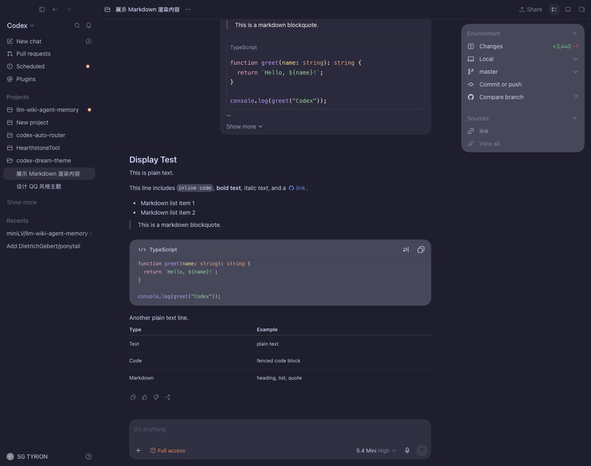
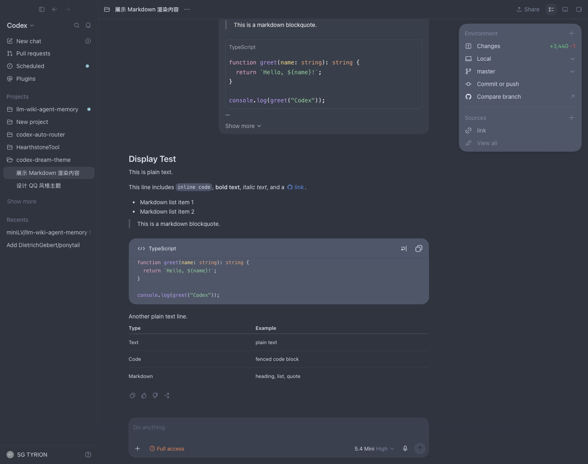
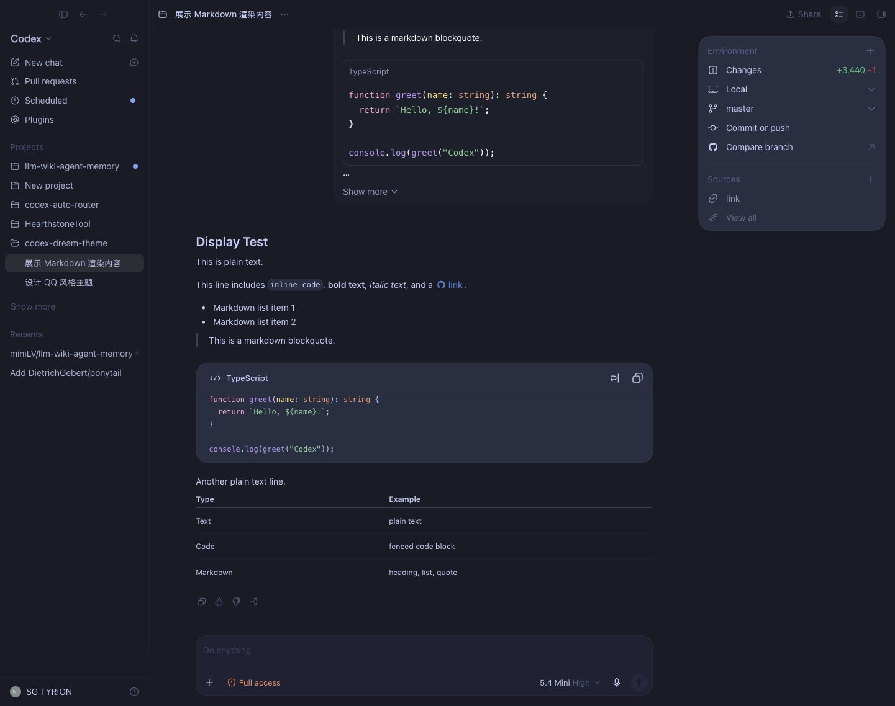
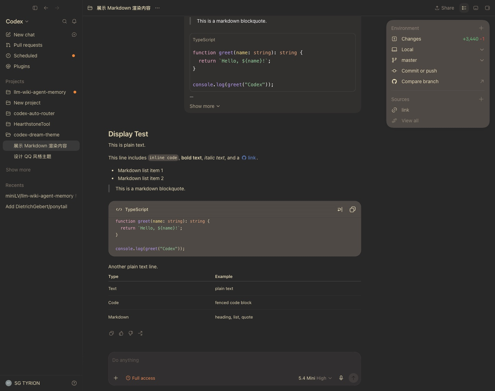
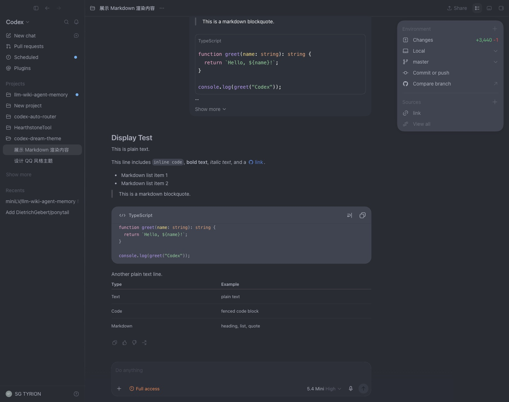

# Anthropic Codex Theme

[中文](./README.md) | **English**

Zero-install themes for Codex: copy a single share string to import Anthropic, Catppuccin, Nord, Tokyo Night, Gruvbox, One Dark, and more.

## Gallery

| Codex Default | Anthropic | Catppuccin Mocha |
|:---:|:---:|:---:|
|  |  |  |

| Nord | Tokyo Night | Gruvbox | One Dark |
|:---:|:---:|:---:|:---:|
|  |  |  |  |

## Import

1. Copy any share string below (or from `share/<slug>.txt`).
2. Open Codex → Settings → Themes → **Import**.
3. Paste the string. Done.

| Theme | Light | Dark |
|---|---|---|
| Anthropic | `share/claude-desktop-light.txt` | `share/claude-desktop-dark.txt` |
| Catppuccin | `share/catppuccin-latte.txt` | `share/catppuccin-mocha.txt` |
| Nord | `share/nord-light.txt` | `share/nord-dark.txt` |
| Tokyo Night | `share/tokyo-night-light.txt` | `share/tokyo-night-dark.txt` |
| Gruvbox | `share/gruvbox-light.txt` | `share/gruvbox-dark.txt` |
| One Dark / One Light | `share/one-light.txt` | `share/one-dark.txt` |

**Anthropic Light:**

```
codex-theme-v1:{"codeThemeId":"codex","variant":"light","theme":{"accent":"#CA7554","contrast":25,"fonts":{"code":"\"JetBrains Mono\", ui-monospace, \"SFMono-Regular\", \"Cascadia Mono\", Menlo, Consolas, monospace","ui":"\"DM Sans\", system-ui, -apple-system, BlinkMacSystemFont, \"Segoe UI\", Roboto, \"Helvetica Neue\", Arial, sans-serif"},"ink":"#38342E","opaqueWindows":true,"semanticColors":{"diffAdded":"#739245","diffRemoved":"#C37967","skill":"#CA7554"},"surface":"#F8F6F1"}}
```

**Anthropic Dark:**

```
codex-theme-v1:{"codeThemeId":"codex","variant":"dark","theme":{"accent":"#CA7554","contrast":55,"fonts":{"code":"\"JetBrains Mono\", ui-monospace, \"SFMono-Regular\", \"Cascadia Mono\", Menlo, Consolas, monospace","ui":"\"DM Sans\", system-ui, -apple-system, BlinkMacSystemFont, \"Segoe UI\", Roboto, \"Helvetica Neue\", Arial, sans-serif"},"ink":"#E8E4DC","opaqueWindows":true,"semanticColors":{"diffAdded":"#7FA84A","diffRemoved":"#C37967","skill":"#CA7554"},"surface":"#1E1D1B"}}
```

See the `share/` directory for every other theme's one-line import string.

## Fonts (optional)

The theme works out of the box with system fonts. For the closest Anthropic feel, install:

| Font | Download |
|---|---|
| **DM Sans** | [Google Fonts](https://fonts.google.com/specimen/DM+Sans) |
| **JetBrains Mono** | [JetBrains](https://www.jetbrains.com/lp/mono/) |

<details>
<summary>Install commands</summary>

**macOS (Homebrew)**
```bash
brew install --cask font-jetbrains-mono font-dm-sans
```

**Windows** — Download, select all `.ttf` → right-click → Install for all users.

**Linux**
```bash
mkdir -p ~/.local/share/fonts
# copy .ttf files there
fc-cache -fv
```

</details>

## Theme Specs

| Theme | Surface | Ink | Accent | Contrast |
|---|---|---|---|---|
| Anthropic Light | `#F8F6F1` warm ivory | `#38342E` warm dark | `#CA7554` muted copper | 25 |
| Anthropic Dark | `#1E1D1B` carbon | `#E8E4DC` warm ivory | `#CA7554` muted copper | 55 |
| Catppuccin Latte | `#EFF1F5` | `#4C4F69` | `#FE640B` orange | 20 |
| Catppuccin Mocha | `#1E1E2E` | `#CDD6F4` | `#FAB387` peach | 45 |
| Nord Light | `#ECEFF4` | `#2E3440` | `#5E81AC` blue | 18 |
| Nord Dark | `#2E3440` | `#D8DEE9` | `#88C0D0` ice | 40 |
| Tokyo Night Light | `#E1E2E7` | `#343B59` | `#2E7DE9` blue | 20 |
| Tokyo Night | `#1A1B26` | `#C0CAF5` | `#7AA2F7` blue-violet | 50 |
| Gruvbox Light | `#FBF1C7` | `#3C3836` | `#D65D0E` orange | 22 |
| Gruvbox Dark | `#282828` | `#EBDBB2` | `#FE8019` orange | 45 |
| One Light | `#FAFAFA` | `#383A42` | `#4078F2` blue | 15 |
| One Dark | `#282C34` | `#ABB2BF` | `#61AFEF` blue | 45 |

## Limitations

Codex import only supports: `surface`, `ink`, `accent`, `contrast`, `fonts`, `opaqueWindows`, `semanticColors`. You cannot independently color the sidebar vs. main canvas — `contrast` is the only lever for panel separation.

## Files

```text
share/
  claude-desktop-light.txt      Import string (light)
  claude-desktop-dark.txt       Import string (dark)
  catppuccin-latte.txt          Catppuccin Latte
  catppuccin-mocha.txt          Catppuccin Mocha
  nord-light.txt                Nord Light
  nord-dark.txt                 Nord Dark
  tokyo-night-light.txt         Tokyo Night Light
  tokyo-night-dark.txt          Tokyo Night
  gruvbox-light.txt             Gruvbox Light
  gruvbox-dark.txt              Gruvbox Dark
  one-light.txt                 One Light
  one-dark.txt                  One Dark
themes/
  *.json                        Full VS Code theme
src/
  theme-spec.mjs                Source of truth
```

## Rebuild

```bash
npm run build      # regenerate themes/ and share/
npm run validate   # build + check JSON + share string format
```
